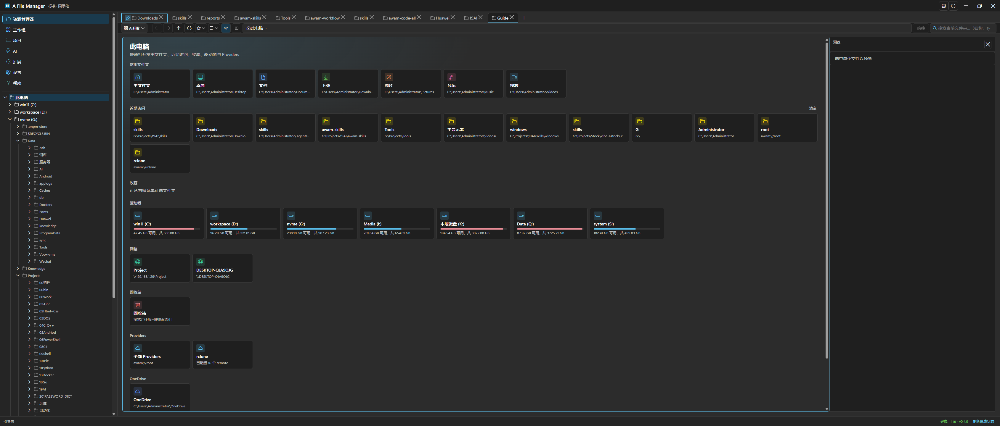
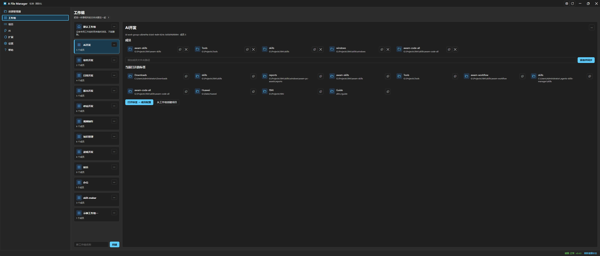
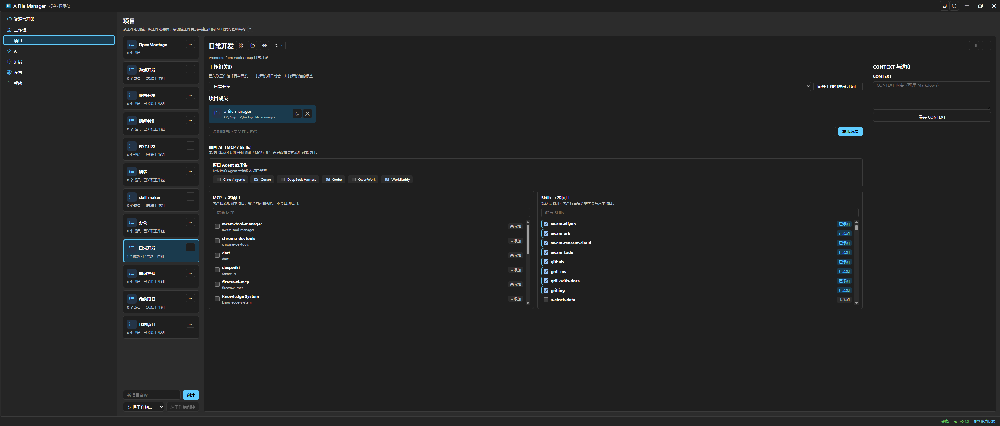
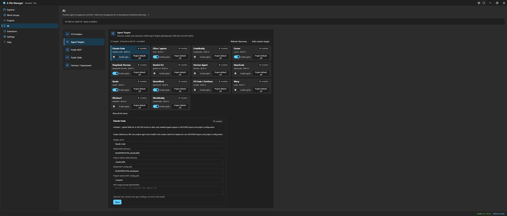
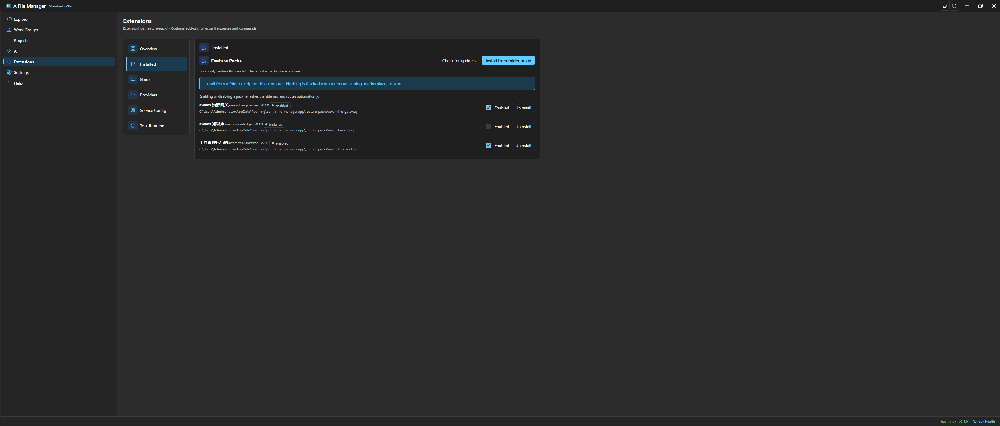

# A File Manager

Windows 优先的现代桌面文件管理器，基于 **Tauri 2 + Vue 3**，采用 Fluent 原生界面。它把双栏浏览、标签页、全局搜索，以及「工作组 / 项目」这类工作现场管理整合到一起 —— 让常用的一批位置可以一键切换、随时回到你正在处理的上下文。

## 界面预览

**资源管理器** —— 侧栏树 + 多标签 + 双栏浏览 + 文件预览：

| 工作组 | 项目 |
|---|---|
|  |  |

| AI 技能与 MCP | 扩展 |
|---|---|
|  |  |

## 主要功能

- **浏览与操作**：列表 / 图标视图、双栏对照、多标签页、面包屑与侧栏（驱动器、常用位置、收藏夹）；复制 / 剪切 / 粘贴、拖放、重命名、删除到回收站并可还原，支持撤销（Ctrl+Z）。
- **工作组（Work Groups）**：把一组常用文件夹存成一个「现场」，切换工作组即恢复对应的标签页；适合按客户 / 任务来回切换。
- **项目（Projects）**：从工作组创建，在磁盘上落地为真实目录，包含公共文档、工作区成员链接与 AI 技能 / MCP 配置，便于围绕一个项目持续工作。
- **全局搜索（Discovery）**：跨多个位置查找文件与应用。
- **虚拟来源与扩展**：接入 rclone、awam-file 网关等虚拟文件系统；通过 Feature Pack 注入可选的工具运行时。
- **可选 AI 能力**：AI 技能与 MCP 作为可选附加组件（另有精简版不含该部分）。
- **外观与本地化**：Fluent 设计语言、深 / 浅色主题；内置中（简/繁）、英、日、德、法多语言。

> Windows 为第一优先平台；macOS 版也在持续构建（见下载）。

## 下载与安装

每个 GitHub Release（由 `v*` 标签发布）都提供安装包：

| 想要的版本 | 下载 |
|---|---|
| **最新版（推荐）** | [releases/latest](https://github.com/awamwang/a-file-manager/releases/latest) |
| **全部版本** | [Releases](https://github.com/awamwang/a-file-manager/releases) |

在 Release 页面下载 `*-setup.exe` 安装即可运行 **A File Manager**。同一版本通常提供两类：

- **主线版 Mainline**（默认含 AI 技能，普通正式版，建议首选）；
- **精简版 Lite**（不含 AI 附加组件，`-lite` 后缀，可选次级）。

macOS 用户下载对应的 `.dmg`（Apple Silicon / Intel）。

若你的电脑还没有 WebView2 运行环境，安装过程会自动为你补齐，无需手动处理。

## 运行环境

- **系统**：Windows 10 / 11（macOS 版见 Releases）。
- **WebView2 Runtime**：运行必需，安装程序会自动处理；也可在「设置 → 健康」里体检。
- **可选依赖**：rclone、awam-file 网关、QuickLook / PowerToys Peek、本机 IDE 等按需安装；缺什么、怎么补，「设置 → 健康」会逐项提示。

## 许可证

[GPL-3.0-or-later](./LICENSE)。个人 / 私有使用没有任何限制；再分发或商用须遵循 GPL（包括提供对应源代码）。

## 开发 / 本地运行 / 参与贡献

- 本地运行、构建、测试门禁与发版流程：[docs/development.md](./docs/development.md)
- 贡献指南与 PR 规范：[CONTRIBUTING.md](./CONTRIBUTING.md)
- 架构与功能地图：[docs/a-file-manager-feature-map.md](./docs/a-file-manager-feature-map.md)
