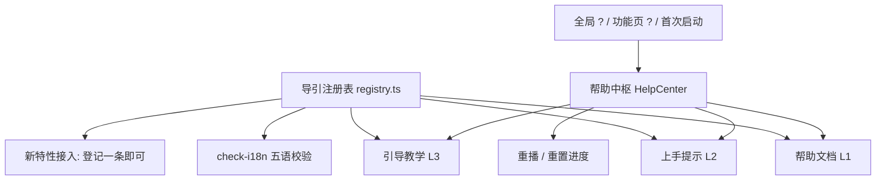

# A File Manager · 应用内帮助与导引（Help & Guidance）设计定稿

> 状态：**已实现并通过独立验证**（2026-11-18）。本文件是 grill-with-docs 两轮访谈的共识汇编，实现已按此落地。
> 权威术语：[glossary-help-guidance.md](./glossary-help-guidance.md) · 架构决策：[ADR 0021](./adr/0021-in-app-help-and-guidance.md)

## 1. 目标

给 AFM 补上从来缺失的一层：面向使用者的帮助。包含三件事——① 帮助文档与用户导引内容；② 基础的「引导教学」工具能力（引导点击按钮完成基础操作）；③ 把现有功能描述从开发者语言改成使用者语言（i18n）。关键约束是**同一套体系必须能被以后的新特性复用**，用来做新特性介绍，而不是一次性工程。

## 2. 三层内容模型

| 层 | 名称 | 触发 | 形态 | 是否要求操作 |
|---|---|---|---|---|
| L1 | 帮助文档 Help Article | 主动查阅 | 静态 Markdown，按功能组织 | 否 |
| L2 | 上手提示 Getting-started Hint | 首次进入功能 / 点「?」 | 一段简短说明 | 否 |
| L3 | 引导教学 Guided Tour | 首次启动主线 / 「?」列表 / 功能页「?」 | 聚光灯逐步演示 | 关键步须真实点击锚点 |

三层共用**一份声明式导引注册表**；用户可见文案全部走 i18n 五语（en / zh-CN / ja / de / fr）。

## 3. 决策总表（两轮共识）

| # | 决策点 | 结论 |
|---|---|---|
| 1 | 交付形态 | 全部做进应用内；`docs/` 仅作内容源；不建独立文档站 |
| 2 | 术语命名 | 帮助文档 / 上手提示 / 引导教学三层；新命名空间 `help.*` `tour.*`；`guide.*` 保留给「此电脑」起始页；写入 GLOSSARY |
| 3 | 教学交互 | 聚光灯 + `data-tour-id` 稳定锚点 + 可跳过/重播；关键步须真实点击才推进 |
| 4 | 触发方式 | 三入口共用一份教学定义：首次启动主线（浏览/搜索/标签）、全局「?」中枢、各功能页「?」深链；进度本地记忆、可重置 |
| 4+ | 重播/重置（用户补充） | 「?」中枢 = 逐项「重播此教学」+ 单个「重置所有上手进度」；重置只清教学已看标记，不动用户数据/设置 |
| 5 | 文案改造范围 | 只改用户可见的描述类字段（description / meta / empty / hint / tooltip / confirm）；调试与状态栏文本保留 |
| 6 | 复用契约 | 单一导引注册表 + `check-i18n` 校验注册表 key 五语齐全 + CONTRIBUTING/PR 模板勾选项 |
| R2-1 | 文档送达与入口 | 构建期 Vite `?raw`/`import.meta.glob` 内嵌 Markdown，不走 IPC / 不改 Rust；`/help` 视图 + 全局「?」；各页「?」深链 |
| R2-2 | 重播 vs 重置语义 | 重播 = 再放一遍、不改进度；重置 = 清已看标记、使首次自动播放可再次触发；后者仅清教学进度 |
| R2-3 | 锚点缺失/功能不可用 | 注册表声明适用条件（视图/路由、feature flag、平台），不满足则不注册；运行时缺锚点则跳过该步并继续，绝不卡死 |
| R2-4 | 平台/风味差异 | 教学文案复用与界面相同的 i18n key，走既有 `platformTerms` 覆盖层（Finder/Trash/⌘）；AI 教学随 `VITE_AFM_AI_ADDON` 构建风味注册 |
| R2-5 | 五语对齐策略 | 以改 value 为主、保持 key 集合不变以自动维持对齐；确需新 key 时一次补齐五语真译文，不拿英文兜底 |

## 4. 目标结构（实现阶段预期新增/改动）

> 以下是**规划**，不是已写代码。确认后按此落地。

```
src/help/
  registry.ts          # 导引注册表：单一契约，含适用条件
  types.ts             # HelpEntry / Hint / TourStep 类型
  content/             # 帮助文档 Markdown（Vite ?raw 内嵌）
  components/
    HelpCenter.vue     # 帮助与导引中枢（列表 + 重播 + 重置）
    GuidedTour.vue     # 聚光灯教学引擎（高亮/气泡/下一步/跳过）
    HintBubble.vue     # 上手提示
  progress.ts          # 已看/已完成进度（本地持久化）
src/views/HelpView.vue # /help 路由视图
src/i18n/locales/*.json # 新增 help.* / tour.*；去术语化改 value
scripts/check-i18n.mjs  # 扩展：校验注册表 key 五语齐全
CONTRIBUTING.md         # PR 模板勾选项
```



## 5. 明确不做（Boundary）

- 不做独立文档站或外链帮助；文档与 App 同仓同版本。
- 不做强制模态向导；教学随时可跳过。
- `Guide` 一词继续专属于起始页，不用于教学。
- 「重置上手进度」不动任何用户数据、设置、文件。
- 调试/状态栏文本不做面向用户改写。

## 6. 待确认

请确认以上 11 项决策与第 4 节结构。**确认后才开始写实现代码**；如需调整（例如教学范围先缩到核心 5 个功能、或注册表字段命名），现在提出最省成本。
